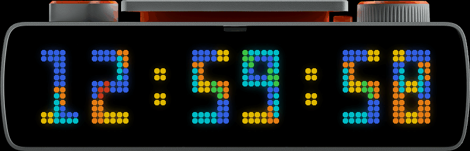

# Blocks Clock for the BUSY Bar

A clock for the [BUSY Bar](https://busy.app), inspired by a famous game. Ported to JavaScript from my [native clock app](https://github.com/Negenii/busybar-tetris). Runs on the stock firmware 1.4.1 or newer.



## Install

Find **Blocks Clock** in the BUSY Apps Catalog and install it.

## Controls

On the clock, turn the wheel to change the colour. Press OK to switch the animation on or off. Back to close the app.

More controls available at Setup menu: colour, 12 or 24 hours, seconds on or off, how the seconds animate, speed, the colon and the animation switch.

## Technical guts

Each digit is a 6x12 bitmap covered exactly by tetrominoes. `tools/covers.mjs` finds the covers once, since on the bar the search takes seconds, and the app drops the pieces in live, sending only the digit columns that changed. That gives about 15 frames per second on the bar.

## Build

Only if you want to build it yourself:

```sh
npm ci
npm run build
```

The package ends up in `dist/me.negenii.blocks-clock.tgz`.

## Credits and license

The BUSY Bar picture in `docs/` is Flipper Devices' render, used under CC-BY 4.0.

Code: MIT
